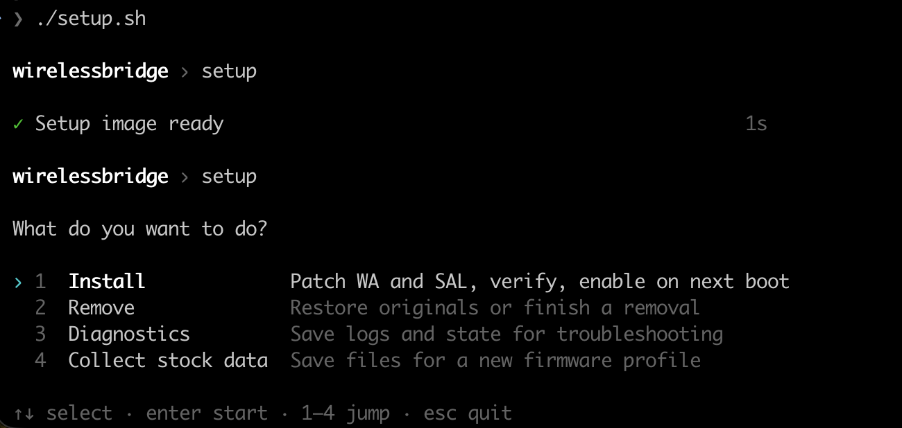

# Mib2Air for MIB STD2

Just a backup with a slightly better name, in my opinion. ;)

(Maybe I'll add some features later, who knows?)

> [!WARNING]
> **Experimental software. Use entirely at your own risk.** WirelessBridge patches
> and runs modified copies of your head unit's own services and edits its startup and
> firewall configuration. It has had limited hardware testing and may leave the unit
> misbehaving or require recovery. It is provided as is, without warranty of any kind,
> and the authors accept no responsibility or liability for any damage to your unit,
> vehicle, phone or data, or for any other consequence of using it. Only proceed if
> you have a working recovery method and backups.

Wireless Android Auto for MIB2 STD2 (MST2) head units, built on the unit's original
WirelessAdapter and SAL services. Setup runs on your computer in Docker, patches copies
of those services for your exact firmware and installs them beside the originals.
Unknown firmware is never patched.

## How it works

The MIB already has a Wi-Fi hotspot and Bluetooth; WirelessBridge teaches its own
Android Auto services to use them instead of a USB cable.

1. **Bluetooth starts the connection.** When your paired phone connects to the car over
   Bluetooth, the unit offers wireless Android Auto and sends the phone the details of
   the MIB's own Wi-Fi hotspot.
2. **The phone joins the MIB's hotspot.** It connects to the network you enabled in the
   stock Wi-Fi menu, the same way it would join any car with built-in wireless
   Android Auto. Your hotspot name and password are only read, never changed.
3. **Android Auto runs over Wi-Fi.** The unit accepts the phone's connection and hands
   it to its original Android Auto receiver, so the session looks and behaves like a
   USB one. The phone appears in the MIB's smartphone list as **Wireless AA**.

In everyday use:

- Plugging the phone in by USB still works as before; while a USB session is active,
  wireless connections are not accepted.
- Turning the MIB's hotspot off disables wireless Android Auto until you turn it on again.
- Nothing in the firmware is replaced. The patched services run from their own folder
  beside the originals, and if one of them stops, the unit restarts the original
  service. **Remove** in setup restores the original configuration.

## Supported firmware

| Firmware | Variant | Status |
| --- | --- | --- |
| P0480T | cpu | Supported |

Versions not listed above are refused. To ask for one, collect stock data from your unit as
described in [Adding a firmware version](docs/DEVELOPMENT.md#adding-a-firmware-version).

## Requirements

- Docker on your computer.
- Permanent Telnet and FTP access to the MIB, enabled with
  [mib-std2-pq-zr-toolbox](https://github.com/olli991/mib-std2-pq-zr-toolbox).
- A recovery path if the unit stops responding over the network: a DUB-E100 USB
  Ethernet adapter or a USB-to-TTL serial adapter on the Quadlock connector.

Details and wiring are in the [setup guide](docs/SETUP.md#before-you-start).

## Usage

On Windows, start Docker Desktop with Linux containers, extract the source ZIP,
and double-click `setup.bat`, or run this from PowerShell:

```powershell
.\setup.bat
```

No Git Bash, host Python, or separate WSL distribution is needed. The launcher
checks Docker, prepares the image and opens the same setup menu. Its window stays
open after setup exits so errors remain visible. Docker Desktop itself must already
be installed and configured.

On macOS or Linux:

```sh
./setup.sh
```

Choose an action and follow the prompts. Install, update, removal, diagnostics and
stock-data collection are explained in the [setup guide](docs/SETUP.md).



## Documentation

- [Setup guide](docs/SETUP.md): preparation, every setup action and what changes on the unit.
- [Development](docs/DEVELOPMENT.md): repository layout, offline builds and adding firmware.

## License

[MIT](LICENSE). Protocol references are credited in
[THIRD_PARTY_NOTICES.md](THIRD_PARTY_NOTICES.md).

This project is not affiliated with or endorsed by Volkswagen Group, Google or the
head unit manufacturers.
